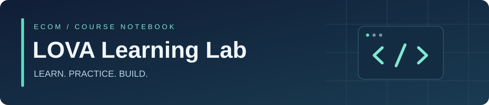

<div dir="rtl">

<div align="center">



# מחברת הלימודים של לוֹבה

**ללמוד · לתרגל · לבנות**

Python · SQL · Data · Machine Learning · OOP · Deep Learning · NLP

[מפת השיעורים](LESSONS_INDEX.md) · [התקדמות אישית](LEARNING_PROGRESS.md) · [הכנת סביבת עבודה](PYTHON_ENVIRONMENT.md)

</div>

---

## מתחילים מכאן

| המטרה שלי | לאן נכנסים |
|---|---|
| לחזור לחומר האחרון שהועלה לענף זה | [מבוא ל־spaCy](07-nlp/2026-11-04-spacy-introduction/) · [8 תרגילי NLP](07-nlp/2026-11-04-spacy-introduction/homework/) |
| לתרגל תכנות מונחה עצמים | [צורות ומחלקות מופשטות](05-oop/2026-11-01-shapes-abstract-classes/) · [מתג אור](05-oop/2026-11-01-light-switch/) |
| למצוא שיעור ישן | [לפי נושא ותאריך](LESSONS_INDEX.md) |
| להוסיף חומר חדש בלי ליצור בלגן | [מדריך הוספת שיעור](HOW_TO_ADD_A_LESSON.md) |

## תחומי הלימוד

| תחום | מה לומדים |
|---|---|
| **01 · [יסודות Python](01-python-basics/)** | תנאים, לולאות, אוספים ופונקציות |
| **02 · [SQL ומסדי נתונים](02-sql-databases/)** | טבלאות, קשרים, JOIN וצבירה |
| **03 · [ניתוח נתונים](03-data-analysis/)** | NumPy ו־Pandas |
| **04 · [למידת מכונה](04-machine-learning/)** | רגרסיה, KNN, KMeans ו־DBSCAN |
| **05 · [תכנות מונחה עצמים](05-oop/)** | מחלקות, ירושה, הפשטה ו־State Pattern |
| **06 · [למידה עמוקה](06-deep-learning/)** | רשתות עצביות עם TensorFlow/Keras |
| **07 · [עיבוד שפה טבעית](07-nlp/)** | spaCy, ישויות, חלקי דיבר וניתוח טקסט |

## מעבר לשיעורים

[פרויקטים](projects/README.md) · [ניסויים](experiments/README.md) · [נתונים](datasets/README.md) · [מדריכים ותיעוד](docs/README.md)

**איך המאגר בנוי:** תחום ← שיעור ← קוד, תרגילים ו־README מקומי. דף הבית מכוון לתחומים; כל README מסביר את התיקייה שבה הוא נמצא. האינדקס המרכזי מאפשר חיפוש מפורט, ויומן ההתקדמות מתעד הבנה אישית בנפרד מקיום קוד.

## הרצה ראשונה

משורש המאגר, עם Python 3.10 ומעלה:

```bash
python3 05-oop/2026-11-01-light-switch/main.py
```

התרגיל הזה משתמש רק בספרייה הסטנדרטית. תרגילים אחרים דורשים ספריות, נתונים או קלט: בדוק את ההוראות בתוך השיעור. [מדריך Python](PYTHON_ENVIRONMENT.md) · [מדריך VS Code](docs/vscode-guide.md).

## מאגרי לימוד נוספים

[שיעורי בית](https://github.com/LOVA-malamud/ekom_home_work) · [חומר למבחן ML](https://github.com/LOVA-malamud/machine_learning_exam_b)

## מה חשוב לדעת על החומר?

- זהו מאגר לימודי: יש פתרונות, טיוטות, קבצים ריקים ותרגילים שעדיין דורשים תיקון. קוד קיים אינו הוכחה להבנה עצמאית.
- קבצים שסומנו **מקומי בלבד** אינם כלולים ב־GitHub. תיקיית Pandas, למשל, מכילה כאן תיעוד ולא את המחברת עצמה.
- תאריכים חסרים נשארים מסומנים, בלי להמציא שנה. קובץ Vehicle בענף זה עדיין ריק.
- [דוח הסידור הנוכחי](docs/organization-2026-11-16.md) מסביר את ההעברות, פערי הענפים ותוצאות הבדיקה. [מפת המעבר הישנה](docs/migration-map.csv) נשמרת כתיעוד היסטורי.

</div>
